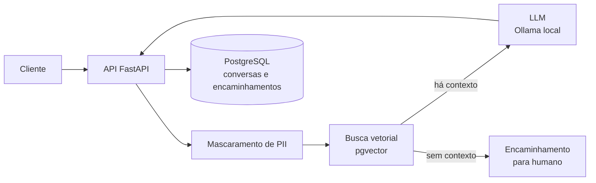

# VaultPay Support Copilot

[](https://github.com/Nathaly-Dev/vaultpay-support-copilot/actions/workflows/ci.yml)

Chatbot de atendimento ao cliente com RAG que responde dúvidas com base nas políticas da empresa, **sempre citando a fonte**, e encaminha para um atendente quando não sabe.

> ⚠️ **A VaultPay é uma empresa fictícia.** Todos os documentos, políticas e dados deste projeto são inventados, para fins de estudo e portfólio.

> 🚧 **Em andamento.** O atendente responde por uma API local (FastAPI), citando a fonte ou encaminhando, e grava cada conversa. Ainda sem interface e sem avaliação de qualidade medida. Veja o [Roadmap](#roadmap).

## O problema

Em uma fintech, boa parte do atendimento são perguntas repetidas cuja resposta já está nas políticas (Pix, tarifas, cartão, segurança). Um chatbot genérico resolve o volume, mas cria dois riscos:

- **Alucinação:** inventar uma regra que não existe, o que em serviços financeiros gera prejuízo e reclamação.
- **Vazamento de dados pessoais:** clientes digitam CPF, e-mail e telefone na conversa, e enviar isso a um LLM sem cuidado fere a LGPD.

## A solução

- Responde **só com base nos documentos de política** e cita a fonte de cada resposta.
- Quando a resposta não está na base, diz *"não sei, vou encaminhar para um atendente"*, sem inventar.
- **Mascara CPF, e-mail e telefone** antes de qualquer texto chegar ao LLM ou ao banco.
- Registra conversas e encaminhamentos para análise posterior.
- Mede a qualidade com Deepeval: taxa de alucinação e % de respostas com fonte.

## Arquitetura (planejada)



## Stack

| Camada | Tecnologia | Por quê |
|---|---|---|
| API | Python, FastAPI | Tipagem com Pydantic e validação na borda |
| Banco + vetores | PostgreSQL + pgvector | Dados relacionais e vetores no mesmo banco, sem serviço extra |
| Embeddings | sentence-transformers (multilíngue, local) | O projeto é em português; custo zero |
| LLM (desenvolvimento) | Ollama local | Custo zero |
| LLM (demo e avaliação) | OpenAI | Só no fim, com orçamento limitado |
| Orquestração | LangChain | A decidir: comparar com um pipeline escrito à mão antes de adotar |
| Análise | Pandas | Análise de conversas e encaminhamentos |
| Avaliação | Deepeval | Alucinação e respostas com fonte |
| Infra | Docker | Ambiente reproduzível |

## Como rodar

Pré-requisito: [Docker Desktop](https://www.docker.com/products/docker-desktop/).

1. Crie o `.env` a partir do exemplo e defina uma senha em `POSTGRES_PASSWORD`:
   ```bash
   cp .env.example .env
   ```
2. Suba o banco (na primeira vez, o schema de `db/migrations/` é aplicado automaticamente):
   ```bash
   docker compose up -d
   ```
   Se aparecer `ports are not available`, outro PostgreSQL já usa a porta 5432: troque `POSTGRES_PORT` no `.env` (ex.: `5433`) e rode o comando de novo.
3. Rode o teste de fumaça do schema:
   ```bash
   docker compose cp db/smoke_test.sql db:/tmp/smoke_test.sql
   docker compose exec db psql -U vaultpay -d vaultpay_copilot -v ON_ERROR_STOP=1 -f /tmp/smoke_test.sql
   ```
4. Banco criado antes de uma migration nova? O Docker só aplica `db/migrations/` na criação do banco; aplique as novas à mão, em ordem (a 002 e a 003 podem rodar mais de uma vez sem erro):
   ```bash
   docker compose cp db/migrations/002_escalation_service_unavailable.sql db:/tmp/002.sql
   docker compose exec db psql -U vaultpay -d vaultpay_copilot -v ON_ERROR_STOP=1 -f /tmp/002.sql
   docker compose cp db/migrations/003_keyword_search.sql db:/tmp/003.sql
   docker compose exec db psql -U vaultpay -d vaultpay_copilot -v ON_ERROR_STOP=1 -f /tmp/003.sql
   ```

## Ingestão das políticas

Pré-requisito: Python 3.12. A instalação usa o lockfile com hashes (mesmas versões em qualquer máquina):

```bash
py -3.12 -m venv .venv
.venv/Scripts/python -m pip install --require-hashes -r requirements-ml.txt -r requirements-dev.txt
```

`requirements.txt` é só o núcleo (banco e configuração) e é o que o CI usa; `requirements-ml.txt` inclui o modelo de embeddings (PyTorch) e foi gerado no Windows.

Com o banco no ar, leia `data/policies/*.md`, gere os embeddings e grave no banco (idempotente: rodar de novo só refaz o que mudou). Na primeira vez baixa o modelo `multilingual-e5-small` (~470 MB):

```bash
PYTHONPATH=src .venv/Scripts/python -m vaultpay_copilot.ingestion.ingest
```

Testes (os de ingestão usam o banco real e desfazem tudo no final):

```bash
.venv/Scripts/python -m pytest -q
```

Busca (teste manual): mascara os dados pessoais da pergunta e mostra os 4 trechos mais parecidos, com a similaridade:

```bash
PYTHONPATH=src .venv/Scripts/python -m vaultpay_copilot.rag.retriever "Perdi meu cartão, o que faço?"
```

## O atendente

Pré-requisito: [Ollama](https://ollama.com) instalado (sem conta, roda tudo no seu computador) e o modelo baixado:

```bash
ollama pull qwen3:4b-instruct
```

Pergunte (a resposta vem com a fonte, ou o atendente encaminha para uma pessoa):

```bash
PYTHONPATH=src .venv/Scripts/python -m vaultpay_copilot.rag.assistant "Qual o limite do Pix de madrugada?"
```

Como ele decide, com três travas contra resposta inventada:

1. **Nota mínima:** se nenhum trecho é parecido o bastante (`MIN_SIMILARITY`), encaminha sem chamar o modelo.
2. **Formato fixo:** o modelo devolve `{answerable, answer, source_ids}`, conferido com Pydantic; fora do formato, encaminha.
3. **Fonte conferida:** se citar um trecho que não recebeu, encaminha.

A pergunta é mascarada antes de tudo, a resposta passa pelo mascaramento de novo, e se o Ollama cair o atendente responde "vou encaminhar" em vez de quebrar. O prompt fica em [`src/vaultpay_copilot/rag/prompts/answer-v1.md`](src/vaultpay_copilot/rag/prompts/answer-v1.md); modelo, endereço, tempo limite e nota mínima são configuráveis no `.env` (veja `.env.example`).

Decisões de modelo e chunking em [`docs/decisions/0001-embeddings-e-chunking.md`](docs/decisions/0001-embeddings-e-chunking.md).

## A API

Suba sempre por este comando (ele desliga opções inseguras do uvicorn; o porquê está no ADR):

```bash
PYTHONPATH=src .venv/Scripts/python -m vaultpay_copilot.api
```

Escuta só em `http://127.0.0.1:8000`. Dois endereços:

- `POST /chat` com `{"question": "...", "session_id": "<uuid, opcional>"}` devolve `{session_id, conversation_id, outcome, answer, sources: [{title, article, quote}], question_masked, pii_masked}`. `outcome` é `answered`, `escalated` ou `error` (modelo fora do ar, já encaminhado); `quote` é o começo do artigo citado; `question_masked` é a pergunta como foi gravada (com `[CPF]`, `[EMAIL]`, `[TELEFONE]`) e `pii_masked` diz que tipos foram mascarados, nunca os valores.
- `POST /handoff` com `{"session_id": "<uuid, opcional>"}` chama um atendente sem passar pelo modelo (funciona mesmo com ele ocupado) e grava o encaminhamento com o motivo `user_requested`. Conta no limite de perguntas por minuto.
- `GET /health` diz se o banco e o modelo configurado estão de pé (200) ou qual caiu (503).

Proteções na borda: pergunta de 1 a 1000 caracteres e sem caracteres de controle; corpo até 16 KB; 10 perguntas por minuto por IP; uma pergunta por vez no modelo (quem chega com ele ocupado recebe 503 com `Retry-After`); erro sempre no formato `{"error": {"code", "message"}}`, sem devolver o que foi enviado; headers de segurança e `X-Request-ID` em toda resposta; log sem pergunta, resposta nem IP. Decisões e trade-offs em [`docs/decisions/0002-api-fastapi.md`](docs/decisions/0002-api-fastapi.md).

## Modelo de dados

- **documents:** políticas da VaultPay, com categoria, vigência e hash do conteúdo.
- **chunks:** pedaços dos documentos com embedding (`vector(384)`) e índice HNSW.
- **conversations:** uma linha por pergunta e resposta, com as fontes usadas. Só guarda a pergunta **já mascarada** e não aceita UPDATE (log de auditoria).
- **escalations:** encaminhamentos para humano, com motivo e status.

Regras garantidas pelo próprio banco (constraints e triggers em PL/pgSQL):

- uma resposta marcada como `answered` precisa ter pelo menos uma fonte;
- `updated_at` e `resolved_at` são preenchidos automaticamente;
- embeddings com dimensão errada são rejeitados.

Schema completo em [`db/migrations/001_initial_schema.sql`](db/migrations/001_initial_schema.sql).

## A interface

Chat em React + Vite + TypeScript, em [`web/`](web/), com as peças do [VaultPay Design System](https://github.com/Nathaly-Dev/vaultpay-design-system) `v0.2.0` (cópia em `web/src/design-system/`, conferida por teste: não se edita). Mostra a fonte com o trecho da política, o `[CPF]` no lugar do número depois que o servidor mascara, o protocolo quando encaminha e o botão "falar com atendente". As conversas ficam salvas **só nesta aba** (`sessionStorage`), listadas no menu em "Conversas nesta aba": voltam depois de recarregar, somem ao fechar a aba e cada uma expira 15 minutos depois da última mensagem. Só o texto já mascarado pelo servidor é salvo (o `[CPF]`, nunca o número digitado). O navegador guarda também a escolha de tema.

Pré-requisito: Node 22 ou mais novo. Com a API no ar (seção acima), em outro terminal:

```bash
cd web
npm ci --ignore-scripts
npm run dev
```

Abra `http://127.0.0.1:5173`. Em desenvolvimento, o Vite repassa `/chat`, `/handoff` e `/health` para a API, então ela continua sem CORS. Testes e tipos: `npm run check`.

## Resultados

**Qualidade.** Conjunto de 30 perguntas escritas à mão ([`data/eval/`](data/eval/)): 22 com resposta nas políticas, 8 sem. Mesmo modelo (`qwen3:4b-instruct`), prompt (`answer-v1`) e `MIN_SIMILARITY=0.80` nas duas colunas; só a busca mudou. Com 30 perguntas, cada uma vale 3,3 pontos: por isso os números vão em contagem.

```bash
PYTHONPATH=src .venv/Scripts/python -m vaultpay_copilot.evaluation.run_eval
```

| Medida | Linha de base (2026-10-30): busca por significado | Busca híbrida (2026-11-04, [ADR 0004](docs/decisions/0004-busca-hibrida.md)) |
|---|---|---|
| A busca achou o artigo principal entre os 4 trechos | 18/22 | **21/22** |
| Decisão certa (respondeu quando havia base, encaminhou quando não havia) | 25/30 | **27/30** |
| Encaminhou mesmo havendo base | 4/22 (P010, P016, P017, P029) | **2/22** (P010, P017) |
| Respondeu sem base (o erro mais grave) | 1/8 (P013) | 1/8 (P013) |
| Citou a fonte certa, quando respondeu com base | 17/18 | **20/20** |
| Texto da resposta correto (revisão humana) | em revisão | em revisão |

O que mudou: "empréstimo consignado" (P016) e "investir em ações" (P029) passaram a achar o artigo "não oferece empréstimo, investimentos" pela palavra e foram respondidas certo ("Não, a VaultPay não oferece…"); P028 passou a citar o artigo certo. Nenhuma pergunta piorou. A busca ficou de 24 para 54 ms (mediana), irrelevante perto do modelo.

O que continua errado, e por quê:
- **P017** ("fui cobrada duas vezes"): nenhuma palavra em comum com "compra não reconhecida"; a busca por palavra não ajuda. Não alteramos a política só para passar no teste.
- **P010** ("telefone da central"): a busca acha o artigo; o **modelo** não trata "não atendemos por telefone" como resposta.
- **P013** (celular roubado, sem base): o **modelo** improvisou com o artigo de golpe.
- A nota mínima de similaridade (trava 1) não separa os grupos: sem base 0,84 a 0,85, com base 0,82 a 0,90. Hoje o portão real é o modelo.

Resultados completos em [`data/eval/results/`](data/eval/results/).

**Latência** (2026-10-30, Ryzen 7 5825U sem GPU dedicada, 16 GB, `qwen3:4b-instruct` no Ollama). É medida de velocidade, não de qualidade: as 10 perguntas do medidor só servem de carga.

```bash
PYTHONPATH=src .venv/Scripts/python -m vaultpay_copilot.evaluation.latency
```

| Etapa | Tempo |
|---|---|
| Busca (embedding da pergunta + banco), mediana de 10 | 24 ms |
| Modelo já carregado na memória, mediana de 9 | 9,4 s |
| Modelo descarregado (1ª pergunta depois de uma pausa) | 18,4 s |

O gargalo é o modelo: a busca é cerca de 400 vezes mais rápida. O que mudou com a medição:

- **`LLM_KEEP_ALIVE=30m`** (padrão agora): o Ollama mantém o modelo na memória por 30 min em vez de 5, evitando os ~9 s de carga quando a pausa entre perguntas fica nesse intervalo. Custo: ~3 GB de RAM ocupados.
- **`LLM_NUM_PREDICT` (teto de tokens): sem ganho.** Com teto de 512, a mediana foi 9,6 s (dentro da variação) e nenhum resultado mudou: as respostas já são curtas. Fica desligado, porque um teto baixo cortaria resposta longa válida.
- **Banco por `127.0.0.1` em vez de `localhost`:** no Windows, `localhost` tentava antes o IPv6, onde o Docker não escuta, e cada conexão esperava o tempo limite. Medido pela API (3 perguntas e o `/health`, uma vez): o `/health` caiu de 5,3 s para 0,27 s e cada pergunta ficou ~5 s mais rápida; a suíte de testes caiu de 75 s para 5 s.

## Roadmap

- [x] **Fase 0, fundação:** estrutura do projeto, PostgreSQL + pgvector no Docker, schema com constraints e triggers.
- [x] **Fase 1, ingestão:** políticas fictícias, chunks por artigo, embeddings e gravação no banco.
- [x] **Fase 2, RAG:** mascaramento de PII, busca vetorial, resposta com Ollama citando a fonte, recusa quando não há base (três travas) e registro de conversas e encaminhamentos.
- [x] **Fase 3, API:** `/chat` e `/health` em FastAPI, com validação, limites e logs sem dado pessoal; latência medida.
- [ ] **Fase 4, avaliação:** conjunto de perguntas versionado (incluindo perguntas sem resposta na base) e métricas com Deepeval.
- [ ] **Fase 5, análise e demo:** análise de encaminhamentos com Pandas, demo com OpenAI e aplicação inteira no Docker.

## Segurança e LGPD

- Segredos só no `.env`, que fica fora do Git.
- Banco exposto apenas em `127.0.0.1`.
- Dados pessoais mascarados antes de chegar ao LLM e ao banco.
- Apenas dados fictícios em todo o projeto.

## Licença

[MIT](LICENSE).

## Como usei IA neste projeto

Uso o Claude Code como mentor técnico: ele propõe a estrutura e a modelagem, explica o porquê de cada decisão e escreve partes do código. Eu decido entre as alternativas (por exemplo, aprovei o modelo de dados antes de o schema ser escrito).
