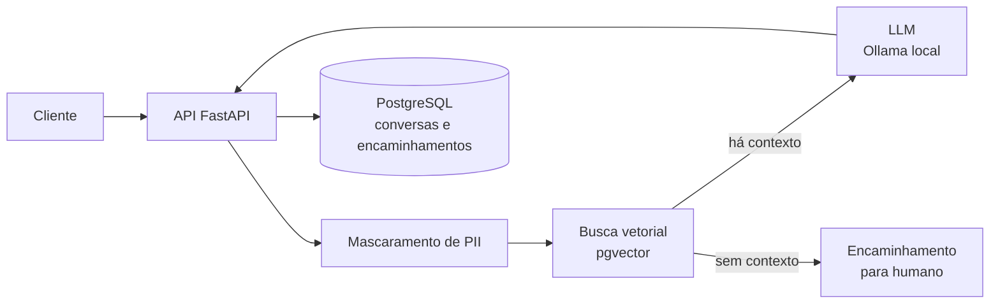

# VaultPay Support Copilot

[](https://github.com/Nathaly-Dev/vaultpay-support-copilot/actions/workflows/ci.yml)

Chatbot de atendimento ao cliente com RAG que responde dúvidas com base nas políticas da empresa, **sempre citando a fonte**, e encaminha para um atendente quando não sabe.

> ⚠️ **A VaultPay é uma empresa fictícia.** Todos os documentos, políticas e dados deste projeto são inventados, para fins de estudo e portfólio.

> 🚧 **Em andamento.** Hoje existe a estrutura do projeto e o banco de dados. Veja o [Roadmap](#roadmap).

## O problema

Em uma fintech, boa parte do atendimento são perguntas repetidas cuja resposta já está nas políticas (Pix, tarifas, cartão, segurança). Um chatbot genérico resolve o volume, mas cria dois riscos:

- **Alucinação:** inventar uma regra que não existe, o que em serviços financeiros gera prejuízo e reclamação.
- **Vazamento de dados pessoais:** clientes digitam CPF, e-mail e telefone na conversa, e enviar isso a um LLM sem cuidado fere a LGPD.

## A solução

- Responde **só com base nos documentos de política** e cita a fonte de cada resposta.
- Quando a resposta não está na base, diz *"não sei, vou encaminhar para um atendente"*, sem inventar.
- **Mascara CPF, e-mail e telefone** antes de qualquer texto chegar ao LLM ou ao banco.
- Registra conversas e encaminhamentos para análise posterior.
- Mede a qualidade com Deepeval: taxa de alucinação e % de respostas com fonte.

## Arquitetura (planejada)



## Stack

| Camada | Tecnologia | Por quê |
|---|---|---|
| API | Python, FastAPI | Tipagem com Pydantic e validação na borda |
| Banco + vetores | PostgreSQL + pgvector | Dados relacionais e vetores no mesmo banco, sem serviço extra |
| Embeddings | sentence-transformers (multilíngue, local) | O projeto é em português; custo zero |
| LLM (desenvolvimento) | Ollama local | Custo zero |
| LLM (demo e avaliação) | OpenAI | Só no fim, com orçamento limitado |
| Orquestração | LangChain | A decidir: comparar com um pipeline escrito à mão antes de adotar |
| Análise | Pandas | Análise de conversas e encaminhamentos |
| Avaliação | Deepeval | Alucinação e respostas com fonte |
| Infra | Docker | Ambiente reproduzível |

## Como rodar

Pré-requisito: [Docker Desktop](https://www.docker.com/products/docker-desktop/).

1. Crie o `.env` a partir do exemplo e defina uma senha em `POSTGRES_PASSWORD`:
   ```bash
   cp .env.example .env
   ```
2. Suba o banco (na primeira vez, o schema de `db/migrations/` é aplicado automaticamente):
   ```bash
   docker compose up -d
   ```
   Se aparecer `ports are not available`, outro PostgreSQL já usa a porta 5432: troque `POSTGRES_PORT` no `.env` (ex.: `5433`) e rode o comando de novo.
3. Rode o teste de fumaça do schema:
   ```bash
   docker compose cp db/smoke_test.sql db:/tmp/smoke_test.sql
   docker compose exec db psql -U vaultpay -d vaultpay_copilot -v ON_ERROR_STOP=1 -f /tmp/smoke_test.sql
   ```

## Ingestão das políticas

Pré-requisito: Python 3.12. A instalação usa o lockfile com hashes (mesmas versões em qualquer máquina):

```bash
py -3.12 -m venv .venv
.venv/Scripts/python -m pip install --require-hashes -r requirements-ml.txt -r requirements-dev.txt
```

`requirements.txt` é só o núcleo (banco e configuração) e é o que o CI usa; `requirements-ml.txt` inclui o modelo de embeddings (PyTorch) e foi gerado no Windows.

Com o banco no ar, leia `data/policies/*.md`, gere os embeddings e grave no banco (idempotente: rodar de novo só refaz o que mudou). Na primeira vez baixa o modelo `multilingual-e5-small` (~470 MB):

```bash
PYTHONPATH=src .venv/Scripts/python -m vaultpay_copilot.ingestion.ingest
```

Testes (os de ingestão usam o banco real e desfazem tudo no final):

```bash
.venv/Scripts/python -m pytest -q
```

Busca (teste manual): mascara os dados pessoais da pergunta e mostra os 4 trechos mais parecidos, com a similaridade:

```bash
PYTHONPATH=src .venv/Scripts/python -m vaultpay_copilot.rag.retriever "Perdi meu cartão, o que faço?"
```

## O atendente

Pré-requisito: [Ollama](https://ollama.com) instalado (sem conta, roda tudo no seu computador) e o modelo baixado:

```bash
ollama pull qwen3:4b-instruct
```

Pergunte (a resposta vem com a fonte, ou o atendente encaminha para uma pessoa):

```bash
PYTHONPATH=src .venv/Scripts/python -m vaultpay_copilot.rag.assistant "Qual o limite do Pix de madrugada?"
```

Como ele decide, com três travas contra resposta inventada:

1. **Nota mínima:** se nenhum trecho é parecido o bastante (`MIN_SIMILARITY`), encaminha sem chamar o modelo.
2. **Formato fixo:** o modelo devolve `{answerable, answer, source_ids}`, conferido com Pydantic; fora do formato, encaminha.
3. **Fonte conferida:** se citar um trecho que não recebeu, encaminha.

A pergunta é mascarada antes de tudo, a resposta passa pelo mascaramento de novo, e se o Ollama cair o atendente responde "vou encaminhar" em vez de quebrar. O prompt fica em [`src/vaultpay_copilot/rag/prompts/answer-v1.md`](src/vaultpay_copilot/rag/prompts/answer-v1.md); modelo, endereço, tempo limite e nota mínima são configuráveis no `.env` (veja `.env.example`).

Decisões de modelo e chunking em [`docs/decisions/0001-embeddings-e-chunking.md`](docs/decisions/0001-embeddings-e-chunking.md).

## Modelo de dados

- **documents:** políticas da VaultPay, com categoria, vigência e hash do conteúdo.
- **chunks:** pedaços dos documentos com embedding (`vector(384)`) e índice HNSW.
- **conversations:** uma linha por pergunta e resposta, com as fontes usadas. Só guarda a pergunta **já mascarada** e não aceita UPDATE (log de auditoria).
- **escalations:** encaminhamentos para humano, com motivo e status.

Regras garantidas pelo próprio banco (constraints e triggers em PL/pgSQL):

- uma resposta marcada como `answered` precisa ter pelo menos uma fonte;
- `updated_at` e `resolved_at` são preenchidos automaticamente;
- embeddings com dimensão errada são rejeitados.

Schema completo em [`db/migrations/001_initial_schema.sql`](db/migrations/001_initial_schema.sql).

## Resultados

Não medido ainda. As métricas de avaliação entram na Fase 4.

## Roadmap

- [x] **Fase 0, fundação:** estrutura do projeto, PostgreSQL + pgvector no Docker, schema com constraints e triggers.
- [x] **Fase 1, ingestão:** políticas fictícias, chunks por artigo, embeddings e gravação no banco.
- [ ] **Fase 2, RAG:** mascaramento de PII, busca vetorial, resposta com Ollama citando a fonte e recusa quando não há base.
- [ ] **Fase 3, API:** endpoints em FastAPI, registro de conversas e encaminhamentos.
- [ ] **Fase 4, avaliação:** conjunto de perguntas versionado (incluindo perguntas sem resposta na base) e métricas com Deepeval.
- [ ] **Fase 5, análise e demo:** análise de encaminhamentos com Pandas, demo com OpenAI e aplicação inteira no Docker.

## Segurança e LGPD

- Segredos só no `.env`, que fica fora do Git.
- Banco exposto apenas em `127.0.0.1`.
- Dados pessoais mascarados antes de chegar ao LLM e ao banco.
- Apenas dados fictícios em todo o projeto.

## Licença

[MIT](LICENSE).

## Como usei IA neste projeto

Uso o Claude Code como mentor técnico: ele propõe a estrutura e a modelagem, explica o porquê de cada decisão e escreve partes do código. Eu decido entre as alternativas (por exemplo, aprovei o modelo de dados antes de o schema ser escrito).
